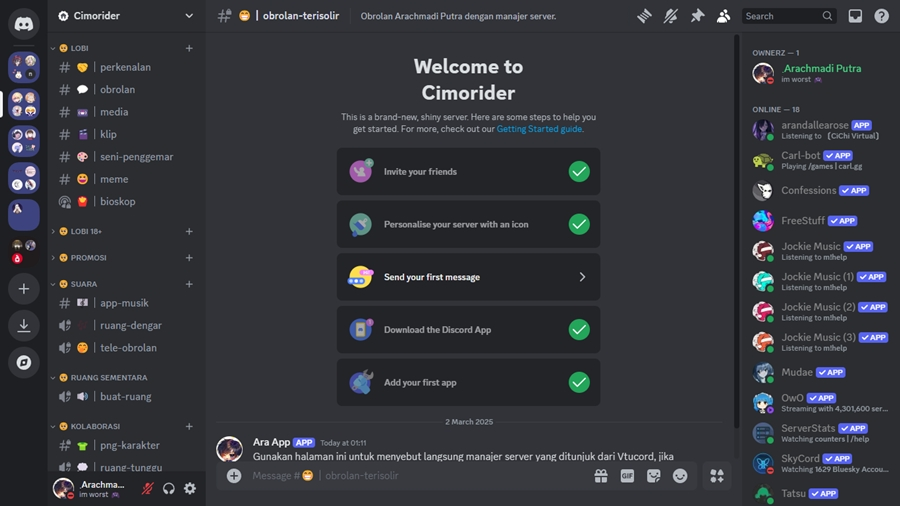
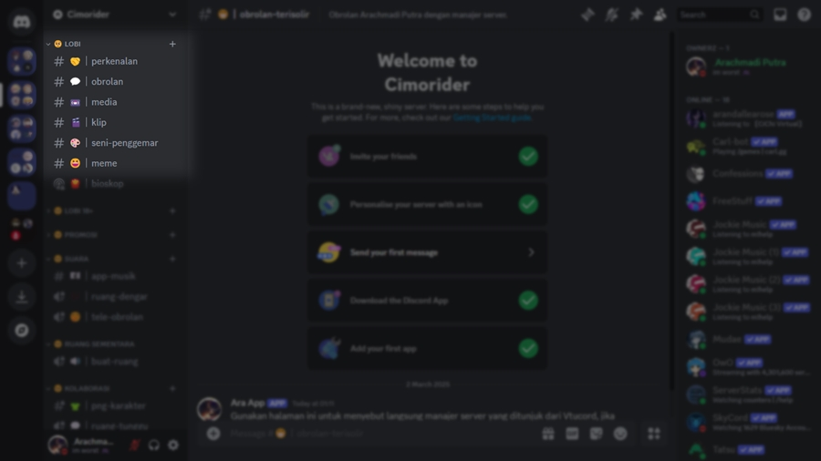
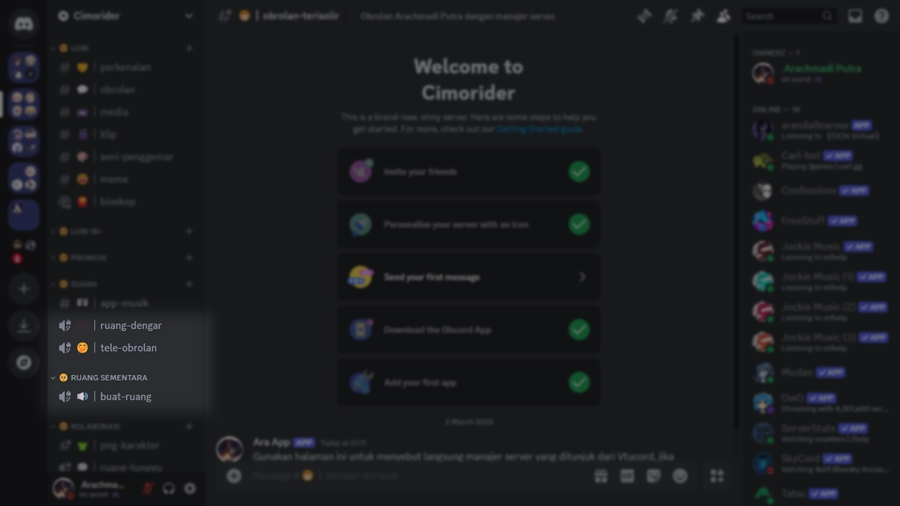

# Apa Itu Server?

### **Cara Menggunakan Channel Text dan Voice**

<figure><figcaption>
Contoh tampilan penuh sebuah server Discord.
</figcaption></figure>

Server pada dasarnya terdiri atas dua channel yang berbeda, yaitu Channel Text dan Channel Voice.

#### Channel Text

**Channel Text** merupakan ruang terpisah untuk berbicara melalui teks. Saluran ini menjaga percakapan tetap teratur dan memberi semua orang cukup ruang untuk berbicara. Buat saluran terpisah untuk setiap topik utama.

<figure><figcaption>
Butir Channel Text.
</figcaption></figure>

#### Channel Voice

**Channel Voice** adalah tempatmu bisa berkumpul via suara dan video. Tidak perlu memutar nomor atau yang lain, cukup klik di salah satu Channel Voice, dan kamu pun langsung terhubung. Teman-teman di servermu ini nanti juga bisa melihat kalau kamu sedang berada di dalamnya, nantinya mereka bisa ikut bergabung, mengobrol atau membagikan tampilan layar mereka.

<figure><figcaption>
Butir Channel Voice.
</figcaption></figure>
