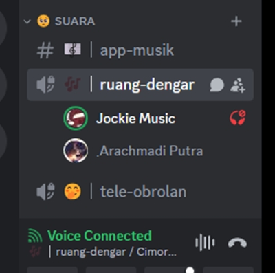
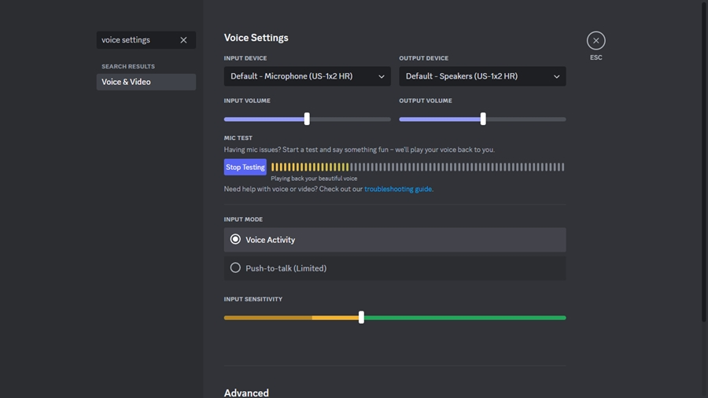
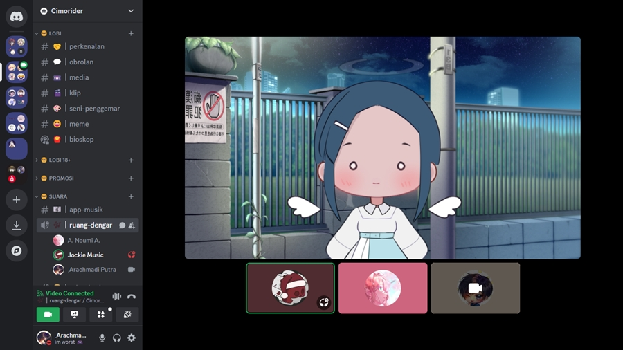
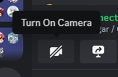
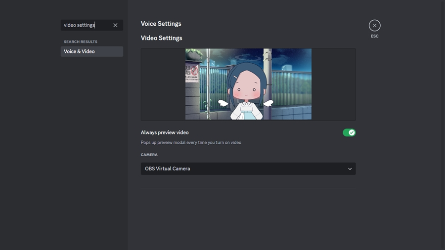
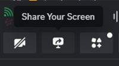
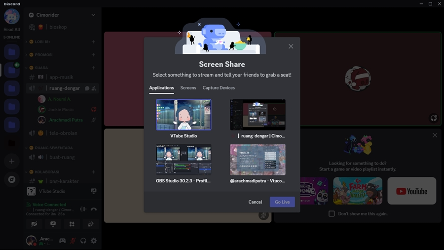
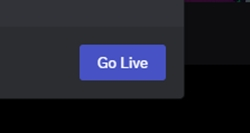
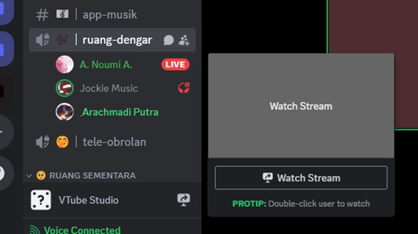

# Cara 'nongkrong' di Server

<figure><figcaption>
Channel Voice
</figcaption></figure>

### **Melakukan Voicecall**



### Gabung ke Channel Voice !

* Klik salah satu Channel Voice yang ingin kamu gunakan.



### Mulai Ngobrol !


Kamu akan melihat lingkaran hijau di sekitar gambar profilmu ketika Discord mendeteksi suaramu.


* Kalau kamu perlu mengubah pengaturan input voicenya, buka **User Settings** (ikon gir di kiri bawah). Di kotak **Search**, ketik **Voice Settings**, nanti akan muncul menu **Voice & Video**, klik menu itu, lalu halaman pengaturan **Voice & Video** bagian **Voice Settings** akan muncul.

<figure><figcaption>
Pengaturan "Voice Settings" di menu "Voice &#x26; Video".
</figcaption></figure>


Kamu bisa mengatur volume dari masing-masing orang yang tergabung di Channel Voice, dengan mengklik kanan avatar orang tersebut.




### Melakukan Videocall

<figure><figcaption>
Contoh aktivitas Videocall.
</figcaption></figure>



### Gabung ke Channel Voice !

* Klik salah satu Channel Voice yang ingin kamu gunakan.



### Bagikan Videomu !

* Tekan tombol "Turn On Camera" di kiri bawah.

<figure><figcaption>
Tombol "Turn On Camera" untuk menggunakan input kamera.
</figcaption></figure>

* Kalau kamu perlu mengubah pengaturan input videonya, buka **User Settings** (ikon gir di kiri bawah). Di kotak **Search**, ketik **Video Settings**, nanti akan muncul menu **Voice & Video**, klik menu itu, lalu halaman pengaturan **Voice & Video** bagian **Video Settings** akan muncul.

<figure><figcaption>
Pengaturan "Video Settings" di menu "Voice &#x26; Video".
</figcaption></figure>



### Melakukan Sharescreen (membagikan tampilan perangkatmu)



### Gabung ke Channel Voice !

* Klik salah satu Channel Voice yang ingin kamu gunakan.



### Aktifkan screenshare !

* Tekan tombol "Share Your Screen" di kiri bawah.

<figure><figcaption>
Tombol "Share Your Screen" untuk memilih tampilan.
</figcaption></figure>



### Pilih jendela aplikasi atau layar untuk dibagikan

* Pilih jendela aplikasi apa, atau tampilan layar mana yang ingin kamu bagikan.

<figure><figcaption>
Sembulan "Screen Share" untuk memilih jendela/layar/alat penangkap mana yang akan dibagikan.
</figcaption></figure>



### Siarkan !

* Tekan tombol "Go Live" setelah memilih tampilan yang akan dibagikan, dan siap.

<figure><figcaption>
Tombol "Go Live" untuk memulai siaran.
</figcaption></figure>



### Menonton Sharescreen (menonton tampilan yang dibagikan)



### Bergabung ke sebuah siaran

* Gabung ke Channel Voice berisi pengguna yang sedang membagikan tampilannya (ditandai dengan ikon "LIVE" berwarna merah).



### Tonton siarannya

* Sorot pengguna yang sedang siaran tersebut, lalu klik tombol "Watch Stream".

<figure><figcaption>
Sembulan "Watch Stream" ketika pengguna yang sedang siaran tersorot kursor.
</figcaption></figure>

Setelah bergabung, kamu bisa menyesuaikan tampilan dan suara dari siaran yang kamu tonton.



