# Tips dan Trik Tambahan

### Mendengarkan Musik Bersama (Spotify Connect)

<figure>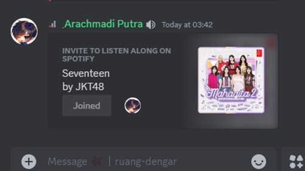<figcaption>
Undangan "Music Together" / mendengarkan bersama menggunakan Spotify Connect.
</figcaption></figure>



### Hubungkan ke Akun Spotifymu

* Pastikan akun Spotifymu sudah terhubung dengan memeriksanya di bagian **Connections** di pengaturan. Buka **User Settings** (ikon gir di kiri bawah). Di kotak **Search**, ketik **Connections**, nanti akan muncul menu **Connections**, klik menu itu.

<figure>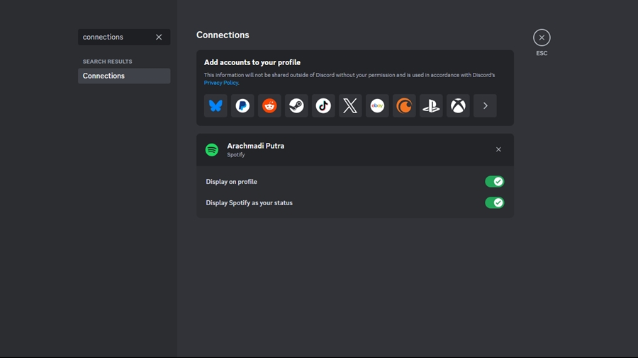<figcaption>
Pengaturan "Connections".
</figcaption></figure>



### Jika akun Spotify belum terhubung

* Di menu Connections, klik tombol "View more" di kotak "Add accounts to your profile".

<figure>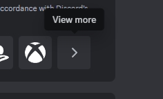<figcaption>
Tombol "View more" untuk menampilkan opsi koneksi yang lain.
</figcaption></figure>

* Setelah sembulan "Add Connection" muncul, pilih Spotify.

<figure>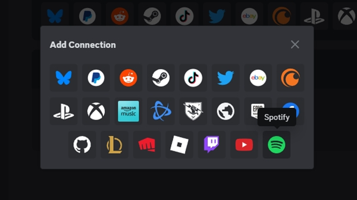<figcaption>
Sembulan "Add Connection" berisi semua platform yang mendukung koneksi ke Discord.
</figcaption></figure>

* Browser akan terbuka, login ke akun Spotifymu, konfirmasi permintaan koneksi dari Discord ke Spotify, tunggu hingga berhasil terhubung.

<figure>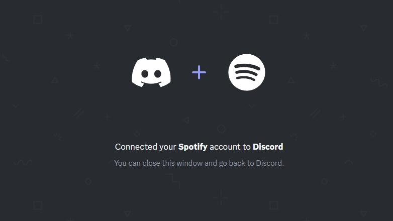<figcaption>
Informasi pada browser bahwa Spotify berhasil dihubungkan ke Discord.
</figcaption></figure>



### Undang temanmu untuk ikut mendengarkan

* Ketika kamu mendengarkan lagu dari Spotify, klik tombol "+" di kotak chat, lalu pilih teman yang ingin kamu undang.

<figure>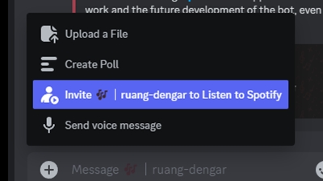<figcaption>
Menu untuk membuat undangan "Music Together" / mendengarkan bersama.
</figcaption></figure>


Penting: Agar dapat bergabung dengan undanganmu, temanmu harus memiliki **Spotify Premium**.




### Membuat Emojimu Sendiri

Hampir semua server Discord punya koleksi emojinya sendiri, dan kamu pun bisa melakukannya untuk servermu. Sulit? Tentu tidak, bahkan gambar hacker satu ini pun bisa dengan mudah digunakan sebagai stiker juga !

<figure><figcaption>
🫶
</figcaption></figure>



### Pastikan kamu punya izin untuk menambahkan emoji ke server tujuan.

Caranya mudah, klik nama server di kiri atas, lalu pilih **Server Settings**. Jika kamu menemukan menu **Emoji** berarti kamu punya izin.

<figure>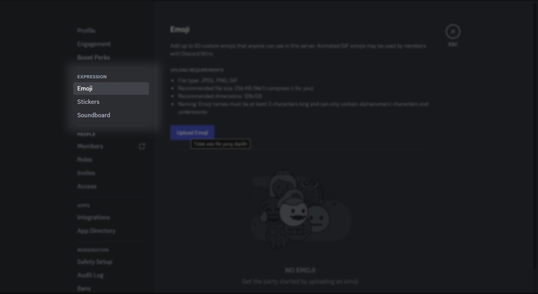<figcaption>
Menu "Emoji" di "Server Settings".
</figcaption></figure>



### Unggah emojimu sekarang !

Di menu **Emoji** tersebut, klik tombol **Upload Emoji**. Pilih gambar emoji favoritmu, dan selesai !


Pastikan gambar emojimu memenuhi kriteria berikut ini :&#x20;

* Berformat JPEG/JPG, PNG, atau GIF.
* Disarankan berukuran 256 KB, atau tidak terlalu besar dari itu.
* Disarankan memiliki resolusi 128x128 piksel.
* Nama emojinya, minimal 2 karakter alfanumerik (angka dan huruf saja), dan underscore.



Ingat, bahwa semua anggota yang berada di server tempat emoji diunggah, dapat menggunakan emoji tersebut, dan anggota yang memiliki langganan Discord Nitro, juga dapat menggunakannya di server lain.




### Menyesuaikan Profilmu



### Buka pengaturan profil

Buka **User Settings** (ikon gir di kiri bawah). Pilih menu **Profiles**.

<figure>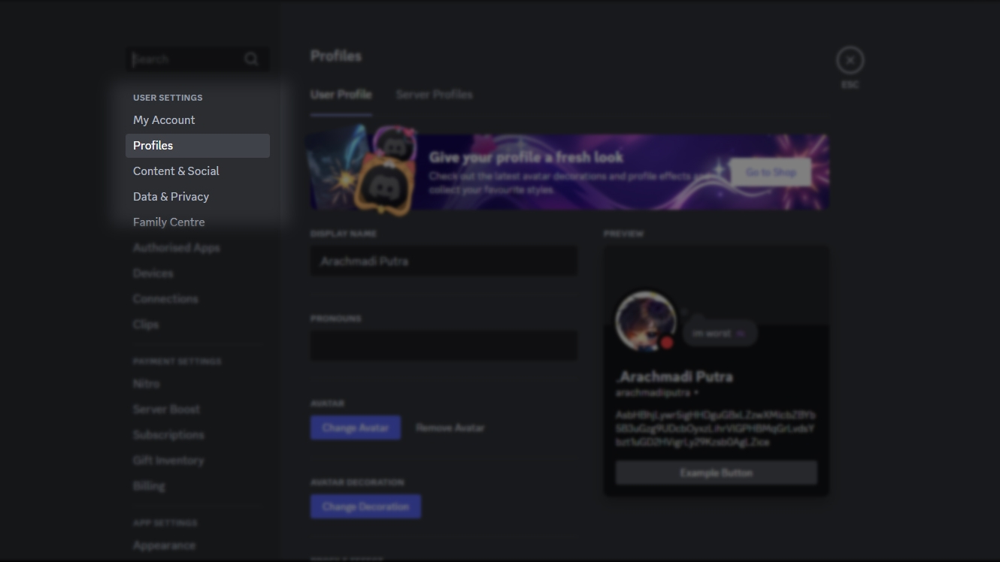<figcaption>
Menu "Profiles" di "User Settings".
</figcaption></figure>



### Ubah gambar profil / avatarmu

Di bagian **Preview** ada pratinjau tampilan profilmu, di sini kamu bisa langsung mengganti gambar profilmu, dengan mengklik gambar profil di pratinjau, lalu pilih **Change Avatar**.

<figure>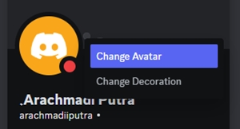<figcaption>
Menu "Change Avatar" saat menekan gambar profil / avatar.
</figcaption></figure>



### Ubah bagian profil yang lain

Lanjutkan ke halaman [Penyesuaian Profil Lanjutan](penyesuaian-profil-lanjutan.md).



### Memformat Teks dengan Markdown

Ingin membuat chatmu lebih rapi atau sekedar memberi penekanan di kata-katanya? Discord memberimu kemudahan untuk ini. Kamu bisa memformat setiap elemen chatmu dengan mudah menggunakan Markdown.

**Apa itu Markdown?**\
Mudahnya, Markdown adalah sistem pemformatan teks sederhana dengan mengutip atau menginisiasi teks menggunakan karakter tertentu.

Berikut adalah beberapa contoh pemformatan teks dasar menggunakan Markdown.

| Nama                | Format                 |
| ------------------- | ---------------------- |
| Teks tebal          | `**Teks**`             |
| Teks miring         | `*Teks*` atau `_teks_` |
| Teks tebal miring   | `***Teks***`           |
| Teks bergaris bawah | `__Teks__`             |

Untuk pemformatan lainnya, lanjutkan ke halaman [Pemformatan Teks Lanjutan](pemformatan-teks-lanjutan.md).

### Menambahkan Status di Voicecall / Videocall-mu

Ingin memberitahu teman-temanmu tentang apa yang sedang dibicarakan dalam Channel Voicemu sebelum mereka bergabung? Tuliskan pesan kecil di bawah Channel Voice agar mereka baca.



### Pastikan kamu punya izin untuk membuat status di Channel Voice.

<figure>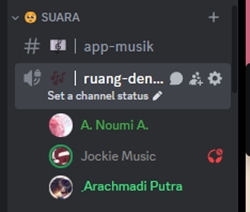<figcaption>
TChannel Voice jika memiliki akses "Set status".
</figcaption></figure>

Periksa Channel Voice, apakah terdapat teks "Set a channel status".

Jika tidak, kamu tidak memiliki izin untuk membuat status.\
Jika ada, lanjutkan ke langkah kedua.



### Tulis statusnya, dan biarkan temanmu tahu.

<figure>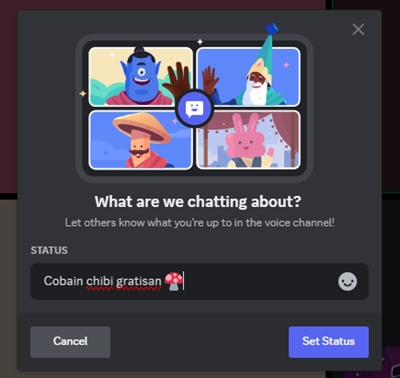<figcaption>
Sembulan "What are we chatting about?" untuk menulis status Channel Voice.
</figcaption></figure>

Klik teks "Set a channel status", lalu akan muncul kotak sembulan "What are we chatting about?", isi keterangannya / status yang ingin ditulis, setelah itu klik "Set Status".

<figure>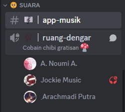<figcaption>
Sudut pandang orang yang belum bergabung ke Channel Voice.
</figcaption></figure>



