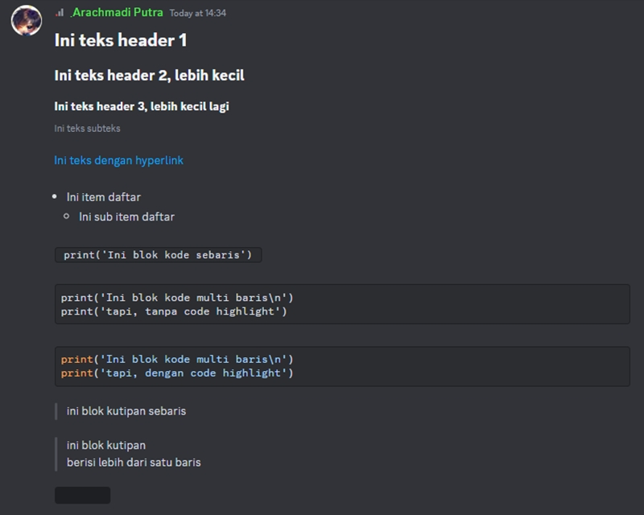
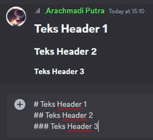
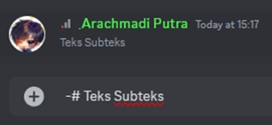
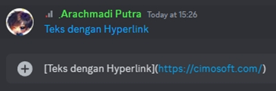
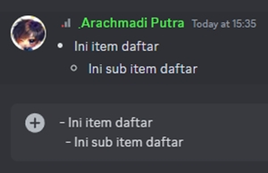
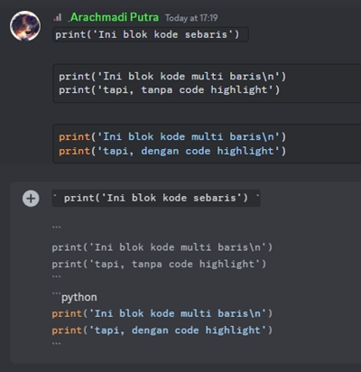
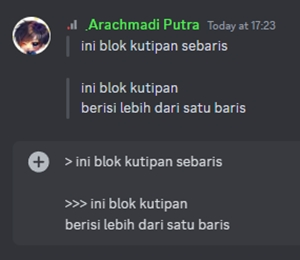
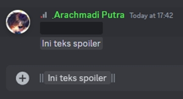
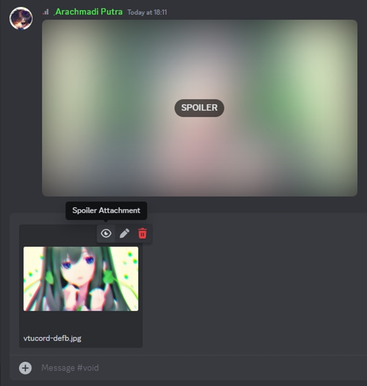

# Pemformatan Teks Lanjutan

<figure><figcaption><p>Sampel macam-macam pemformatan Markdown.</p></figcaption></figure>

### Header

<figure><figcaption><p>Sampel macam-macam Markdown Header.</p></figcaption></figure>

Terdapat 3 (tiga) jenis **header** yang bisa digunakan, dengan cara menambahkan/menginisasi baris teks dengan tanda pagar. Untuk setiap **header**, memiliki jumlah tanda pagar yang berbeda. **Header 1** dengan 1 (satu) tanda pagar (`#`), **Header 2** dengan 2 (dua) tanda pagar (`##`), dan **Header 3** dengan 3 (tiga) tanda pagar (`###`) berturut-turut.


Jangan lupa untuk selalu memberi spasi setelah tanda **header**, atau **header** tidak akan dirender, dan dianggap sebagai teks biasa.


### Subteks

<figure><figcaption><p>Sampel Markdown Subteks.</p></figcaption></figure>

Seperti Header, subteks juga menggunakan tanda pagar sebagai pemformatnya, bedanya di subteks sebelum tanda pagar, didahului tanda minus (`-#`). Alih-alih membuat teks menjadi lebih besar seperti sebelumnya, subteks justru akan membuat teks menjadi dua kali lipat lebih kecil dari ukuran teks biasa. Subteks biasanya berfungsi untuk catatan kaki atau keterangan tambahan.


Jangan lupa untuk selalu memberi spasi setelah tanda **subteks**, atau **subteks** tidak akan dirender, dan dianggap sebagai teks biasa.


### Teks dengan Hyperlink

<figure><figcaption><p>Sampel Markdown Teks dengan Hyperlink.</p></figcaption></figure>

Discord juga mengizinkan untuk membuat teks hyperlink. Yaitu teks yang bisa diklik untuk mengarahkanmu ke suatu halaman web. Caranya, cukup apit kata yang ingin diberi hyperlink dengan kurung siku, lalu tepat di sebelahnya, apit tautan dengan kurung biasa.


Format ini, kadang memicu munculnya embed/informasi tentang halaman web dalam tautan. Untuk menghindari ini, kamu bisa mengapit tautan dengan tanda `<>` di dalam tanda kurung. Jadi kurang lebih seperti ini : `[Teks dengan Hyperlink](<https://cimosoft.com/>)`.


### Item Daftar / List

<figure><figcaption><p>Sampel Markdown Item dan Sub Item Daftar.</p></figcaption></figure>

Ingin membuat item daftar lebih terlihat rapi? Discord bisa membuatnya seperti itu. Cukup awali setiap item daftar dengan tanda minus (`-`) atau asterisk/bintang (`*`), maka setiap item akan tertata rapi.&#x20;

Hal yang sama juga bisa dilakukan untuk membuat item daftar di dalam item (**sub item**) dengan menambahkan dua spasi sebelum tanda minus (`-`) atau asterisk/bintang (`*`).


Jangan lupa untuk selalu memberi spasi setelah tanda minus (`-`) atau asterisk/bintang (`*`), atau item daftar tidak akan dirender, dan dianggap sebagai teks biasa.



**Sub item** harus dibuat tepat di bawah item induk. Selain itu, **sub item** akan dirender seperti item daftar biasa.


### Blok Kode

<figure><figcaption><p>Sampel macam-macam mode Markdown Blok Kode.</p></figcaption></figure>

Mau share skrip ngodingmu? Cukup apit baris skripmu dengan satu backtick (`` ` ``). Ini akan membuat semua teks di dalamnya dirender menjadi teks dengan huruf monospace atau huruf dengan lebar yang sama. Atau gunakan tiga backtick (` ``` `) untuk membuatnya menjadi blok.

Dalam mode blok, kamu juga bisa menerapkan syntax/code highlight dengan cara menambahkan nama bahasa pemrograman setelah backtick pembuka.


Teks yang dikenai blok kode akan dianggap sebagai teks biasa, termasuk seluruh pemformatan Markdown yang ada.&#x20;


### Blok Kutipan / Blockquote

<figure><figcaption><p>Sampel Markdown Blok Kutipan.</p></figcaption></figure>

Format teks ini, cocok digunakan ketika mengutip kata-kata mutiara atau sekedar membuat suatu baris / paragraf menonjol. Blok Kutipan akan membuat garis tebal di samping baris atau paragraf yang dikenai aturannya.

Saat mengetik, kamu bisa memberi tanda `>` di awal baris yang ingin dibuat blok kutipannya, setelah itu, baris selanjutnya akan mengikuti.

Saat menandai teks (teks sudah ada, dan ingin dikenai blok kutipan), gunakan tanda `>` di awal baris untuk menandai satu baris, dan gunakan tanda `>>>` untuk menandai beberapa baris atau paragraf.

Untuk memutus format ini agar bisa kembali ke mode teks biasa, kamu bisa menghapus terlebih dulu garis blok kutipan yang dibuat otomatis ketika kamu membuat baris baru, lalu ketik teksnya.

### Spoiler

<figure><figcaption><p>Sampel Markdown Spoiler.</p></figcaption></figure>

Ketika kamu ingin berbagi cerita/adegan film yang belum ditonton oleh temanmu, lebih baik ceritakan dalam mode ini. Apit kalimat ceritamu dengan dua tanda pipe (`||`), maka seketika teks yang kamu ketik akan ditutupi blok hitam. Di sini temanmu masih bisa memilih, antara membacanya (dengan mengklik blok hitam tersebut), atau membiarkannya.


Jangan pernah meletakkan **spoiler** di dalam **Blok Kode**, karena semua pemformatan teks diabaikan ketika berada di dalam **Blok Kode**.



Tips: format ini tidak terbatas hanya untuk pemformatan teks saja, tapi juga bisa digunakan untuk gambar dan gambar dari tautan yang dibagikan.&#x20;

* **Spoiler pada gambar**



Ketika akan mengunggah berkas gambar,  klik **Spoiler Attachment** (ikon mata) untuk mengaktifkan / menonaktifkan **spoiler**.\
Kamu juga bisa memberi akhiran nama `_SPOILER` di berkas gambar yang akan diunggah, contohnya: `namafile_SPOILER.png`. Ini akan membuat gambar otomatis dispoiler saat gambar diunggah.

* **Spoiler pada tautan**

Terapkan cara yang sama seperti teks biasa, jika embed atau gambar terdeteksi, spoiler akan otomatis diterapkan ke embed atau gambar tersebut.\
Agar lebih aman, alih-alih menspoiler embed, lebih baik langsung matikan embed dari tautan tersebut, dengan mengapitnya menggunakan tanda `<>` seperti: `<https://cimosoft.com>`.


