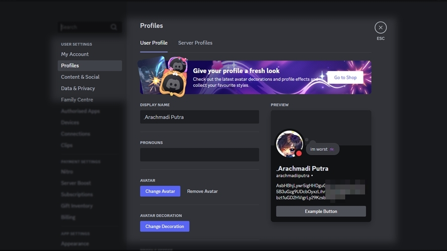
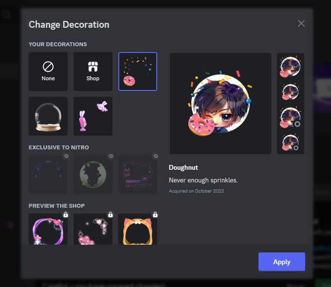
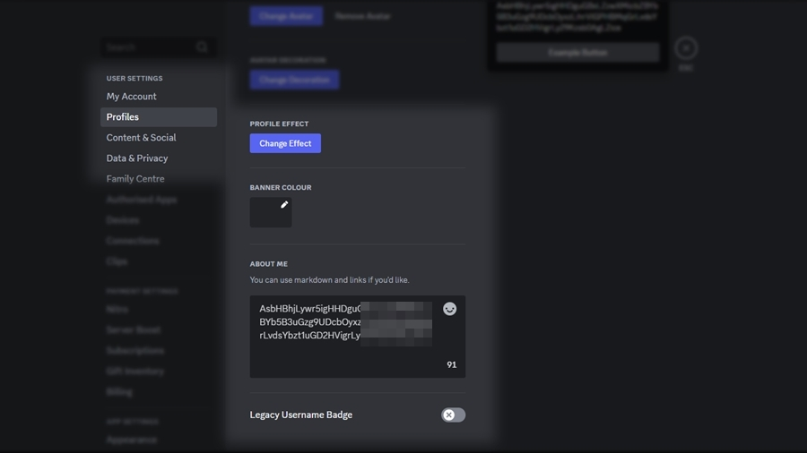
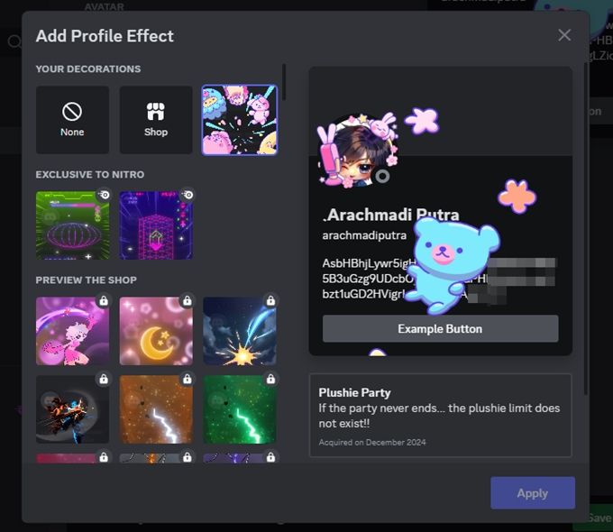
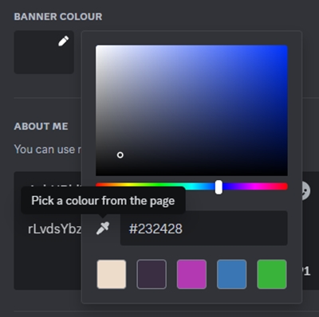
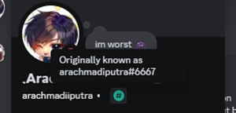

# Penyesuaian Profil Lanjutan

<figure><figcaption>
Pengaturan "Profiles" di "User Settings" (bag. 1).
</figcaption></figure>

### Display Name

Ini adalah nama yang digunakan agar kamu lebih mudah dikenali (daripada `username` yang tanpa spasi dan harus unik). Nama ini akan tampil di profil dan di DM, juga sebagai nama default di server tempatmu bergabung.


Pastikan Display Name kamu memenuhi kriteria berikut ini :&#x20;

* Panjangnya antara 1 s/d 32 karakter.
* Tidak melanggar Pedoman Komunitas Discord.


### Pronouns

Meski biasanya misused, bagian ini sebenarnya digunakan untuk menunjukkan identitas gender kamu, seperti `He/Him`, `She/Her`, `They/Them` dan sejenisnya.

### Avatar

Digunakan untuk mengganti atau menghapus gambar profilmu. Tombol **Change Avatar**, juga muncul ketika kamu mengklik gambar profilmu di bagian **preview**.&#x20;


Jika kamu berlangganan **Discord Nitro** reguler, kamu bisa menggunakan gambar animasi GIF sebagai gambar profil / avatarmu.


### Avatar Decoration

Digunakan untuk menambah bingkai di avatarmu. Kamu bisa mendapatkannya dengan membeli di Shop, atau melalui Quest dan event yang diadakan oleh Discord.

<figure><figcaption>
Sembulan "Change Decoration" untuk menambah bingkai gambar profil / avatar.
</figcaption></figure>

<figure><figcaption>
Pengaturan "Profiles" di "User Settings" (bag. 2).
</figcaption></figure>

### Profile Effect

Digunakan untuk menambah animasi overlay saat profilmu ditampilkan. Sama seperti Avatar Decoration, kamu bisa mendapatkannya dengan membeli di Shop, atau melalui Quest dan event yang diadakan oleh Discord.

<figure><figcaption>
Sembulan "Add Profile Effect" untuk menambahkan animasi overlay saat profil ditampilkan.
</figcaption></figure>

### Banner Colour

Kamu bisa mengganti warna bidang kosong yang ada di belakang gambar profilmu dengan warna lain. Geser titik bulat kecil dan baris di bawahnya untuk memilih warna yang sesuai dengan keinginanmu, atau mengambil sampel warna dari gambar di sekitar tampilan dengan mengklik ikon eyedropper (di sebelah kotak input kode warna), atau langsung mengganti kode warnanya di kotak tersebut.

<figure><figcaption>
Menu pemilihan warna untuk "Banner Colour".
</figcaption></figure>


Jika kamu berlangganan **Discord Nitro** reguler, kamu tidak hanya bisa mengganti banner dengan warna, tapi juga dengan gambar.


### About Me

Tuliskan deskripsi singkat tentang dirimu dalam 160 karakter. Ini juga termasuk karakter untuk [membuat Markdown](./#memformat-teks-dengan-markdown).

### Legacy Username Badge

Jika akun Discordmu dibuat sebelum tahun 2024, kamu akan menemukan bahwa username-mu memiliki discriminator (tagar dengan empat angka unik). Ini adalah cara lama Discord untuk menjaga username agar tetap unik, meski username yang sama digunakan oleh beberapa orang.&#x20;

<figure><figcaption>
Profil akun yang mengaktifkan "Legacy Username Badge"
</figcaption></figure>

Setelah tanggal 4 Maret 2024, Discord melakukan perubahan besar dengan menghapus sistem discriminator ini, dengan menggabungkan karakter acak di belakan username yang banyak digunakan. Memaksa pengguna untuk mengubahnya, karena "tidak estetik".

Tombol ini gunanya adalah untuk menampilkan kembali sistem username lama tersebut di profilmu, agar teman-temanmu bisa menemukan dan mengonfirmasi akunmu.

Jika diaktifkan, akan muncul badge bulatan hijau dengan simbol pagar (`#`) di dalamnya, dan ketika disorot akan muncul username lama berikut discriminatornya.
