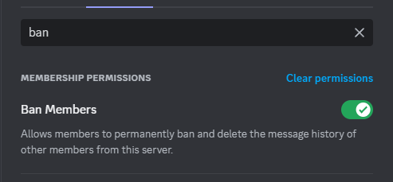
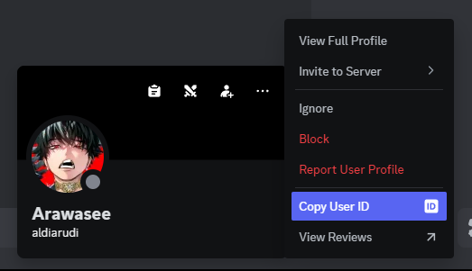
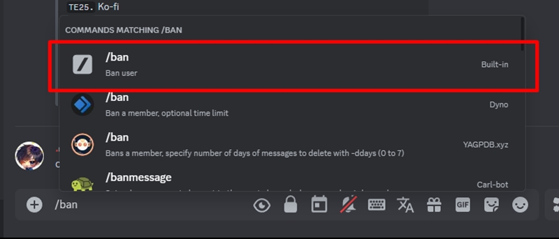
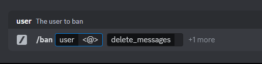
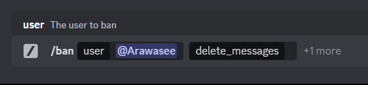
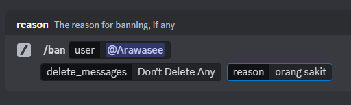
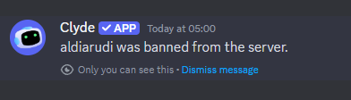

# Ban user yang bukan member server

### Deskripsi

Tips ini berguna jika kamu ingin mencegah seseorang/user yang sudah kamu ketahui akun Discordnya, agar tidak bergabung ke server kamu/server yang kamu urus.

Tips ini membutuhkan User ID akun yang ingin kamu cegah. Discord secara default tidak menampilkan User ID di pop-up menu mereka. Maka dari itu, kita perlu mengaktifkannya terlebih dahulu, sebelum dapat mengambil User ID.


Jika kamu bukan pemilik server, tanyakan pada pemilik server untuk memastikan role kamu setidaknya memiliki permission "Ban Members".



### Versi Desktop / Browser



### Aktifkan "Developer Mode"

Untuk dapat melakukan tindakan ini, kamu harus mengaktifkan "Developer Mode" terlebih dahulu.&#x20;

Petunjuk prosedur ini, tersedia di halaman "[Mengaktifkan Developer Mode](mengaktifkan-developer-mode.md)".



### Salin "User ID" akunnya

Klik kanan di profil akun target, lalu pilih "Copy User ID".

Kamu juga bisa menampilkan profil target terlebih dulu untuk memastikan, lalu klik titik tiga di pojok kanan atas tampilan profil target, dan klik "Copy User ID"

<figure><figcaption>
Menyalin "User ID" dari akun Discord target
</figcaption></figure>



### Jalankan perintah `/ban`&#x20;

Pergi ke sembarang Channel Text yang kotak chatnya mengizinkan pengiriman slash command (tekan tanda slash/garis miring `/` . Jika muncul daftar perintah bot/app, berarti slash command diizinkan.)

Ketik `/ban`, dari daftar perintah yang muncul, pilih yang built-in Discord (dengan ikon garis miring abu-abu).

<figure><figcaption>
Letak perintah "/ban" built-in Discord
</figcaption></figure>



### Masukkan User IDnya

Setelah dipilih, isi kotak "user" dengan "`<@>`".

<figure><figcaption>
Pengisian "&#x3C;@>" di kotak "user"
</figcaption></figure>

Selanjutnya, tempel User ID yang sudah disalin tadi di antara tanda `@` dan `>` .\
Setelah itu, kotak "user" akan otomatis berubah ke username akun tersebut, atau muncul sebagai `unknown-user`, abaikan. Jika muncul `unknown-user` ini normal, karena user tersebut tidak berteman denganmu, atau tidak berada di server tersebut.

<figure><figcaption>
Kotak "user" setelah ditambahkan User ID di "&#x3C;@>"
</figcaption></figure>


JANGAN menekan **Enter** saat berada di kotak "user" untuk menghindari secara tidak sengaja memilih butir user yang muncul di daftar.




### Lengkapi isian lainnya, dan selesaikan

Pilih "delete\_messages" dan sesuaikan pilihannya.

Pilih "+1 more" lalu pilih "reason" untuk mengisi alasan ban ini.

Setelah semua opsi terisi, tekan Enter untuk memproses ban.

<figure><figcaption>
Perintah "/ban" dengan semua kotak sudah diisi
</figcaption></figure>



### Selesai

Tunggu beberapa saat hingga pesan dari Clyde muncul.

<figure><figcaption>
Pesan user berhasil diban
</figcaption></figure>



### Versi Mobile

Untuk saat ini, agar mendapatkan hasil yang sama, gunakan Discord melalui browser perangkat mobile.
