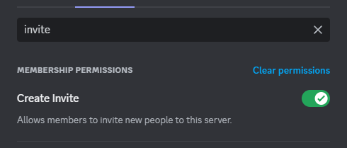
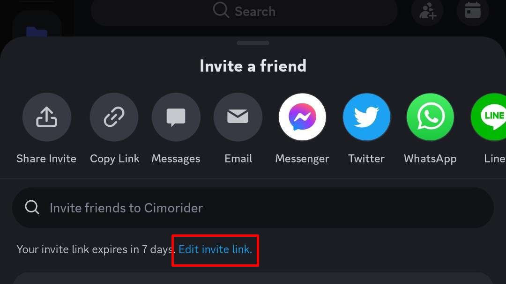
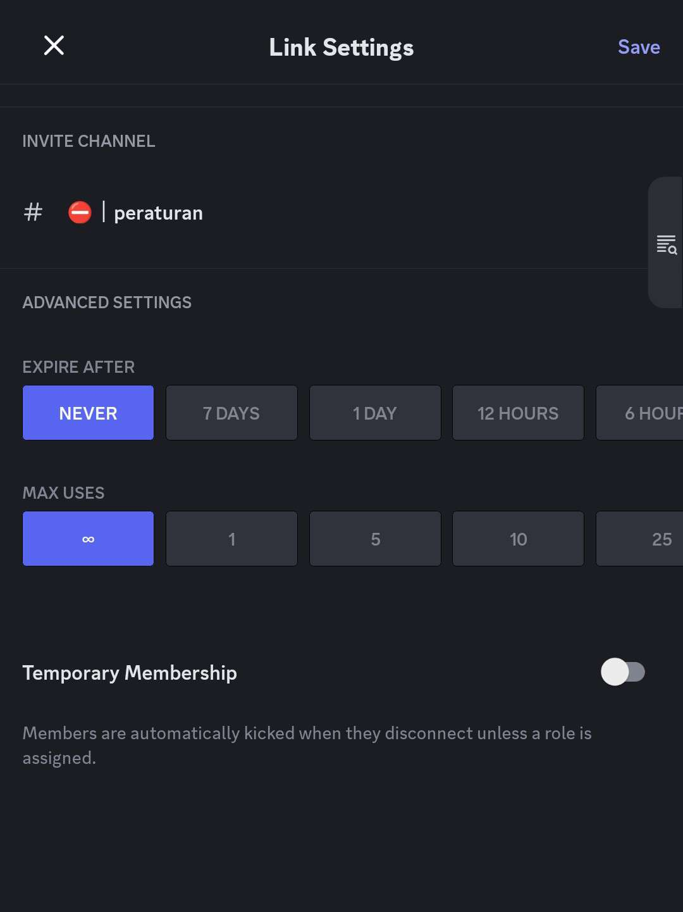
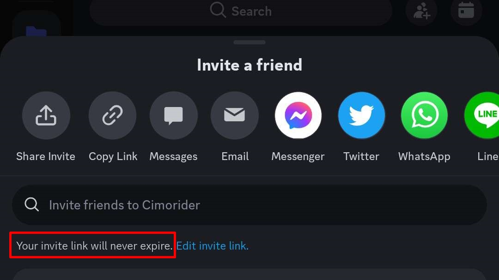

# Membuat undangan permanen

### Deskripsi

Kadang, ketika kamu ingin mengundang temanmu untuk bergabung di servermu, atau ketika kamu ingin menyematkan tautan undangan servermu di profil/deskripsi channel YouTubemu agar siapa pun yang membaca bisa bergabung, ternyata tautan undanganmu sudah kadaluarsa.

Hal ini bisa dihindari dengan membuat tautan undangannya permanen. Dengan begitu, kamu tidak perlu takut tautan undanganmu kadaluarsa lagi.


Jika kamu bukan pemilik server, tanyakan pada pemilik server untuk memastikan role kamu setidaknya memiliki permission "Create Invite".



### Versi Desktop / Browser



### Buat tautan undangannya

Ada beberapa cara membuat tautan undangan di Discord

1. **Melalui pop-up menu ikon server.**\
   Klik kanan pada ikon server, lalu pilih "Invite People"
2. **Melalui menu server.**\
   Klik judul server di kiri atas, lalu pilih "Invite People"
3. **Melalui pop-up menu channel.**\
   Klik kanan pada channel yang ingin dibuat undangannya, lalu pilih "Invite People"


**Cara 1** dan **2** akan mengundang ke channel yang saat ini kamu buka.\
Sementara itu, **cara 3** akan mengundang ke channel yang dibuat undangannya.

Jika kamu ingin mengundang ke channel tertentu (agar member baru langsung diarahkan setelah onboarding), kamu bisa menggunakan **cara 3**, dan ini yang kami sarankan.




### Klik "Edit invite link"

Di kotak dialog "Invite friends to" perhatikan tulisan kecil di bagian paling bawah, "Your invite link expires in 7 days." Ini artinya tautan undangan tersebut akan kadaluarsa dalam 7 hari.

Untuk mengubahnya jadi permanen, klik "Edit inivte link" terlebih dulu.

<figure><figcaption>
Lokasi "Edit invite link"
</figcaption></figure>



### Ubah "Expire After" ke "Never"

Setelah "Edit invite link" diklik, akan muncul kotak dialog "Server invite link settings".

Klik kotak dropdown "Expire After" yang berisi "7 days", dan ganti ke "Never".

<figure><figcaption>
Opsi "Never" pada "Expire After"
</figcaption></figure>



### Klik "Generate a New Link"

Setelah "Never" dipilih, klik "Generate a New Link", dan sebuah tautan undangan baru akan dibuat.

Sekarang, kamu bisa membagikan tautan undangan tersebut dengan mengklik "Copy", dan tidak perlu takut kadaluarsa lagi.

<figure><figcaption>
Keterangan bahwa tautan undangan tidak lagi kadaluarsa
</figcaption></figure>



### Versi Mobile



### Buat tautan undangannya

1. **Melalui menu ikon server.**\
   Tekan dan tahan pada ikon server, lalu pilih "More Options", dan pilih "Invite"
2. **Melalui menu server.**\
   Tekan pada judul server di kiri atas, lalu pilih "Invite"
3. **Melalui menu channel.**\
   Tekan dan tahan pada channel yang ingin dibuat undangannya, lalu pilih "Invite"



### Tekan "Edit invite link"

Di pop-up "Invite a friend" perhatikan tulisan kecil di bawah kotak pencarian, "Your invite link expires in 7 days." Ini artinya tautan undangan tersebut akan kadaluarsa dalam 7 hari.

Untuk mengubahnya jadi permanen, tekan "Edit inivte link" terlebih dulu.

<figure><figcaption>
Lokasi "Edit invite link"
</figcaption></figure>



### Ubah "Expire After" ke "NEVER"

Setelah "Edit invite link" ditekan, akan muncul kotak dialog "Link Settings".

Tekan pilihan "NEVER" di paling kiri pada "Expire After".

<figure><figcaption>
Opsi "Never" pada "Expire After"
</figcaption></figure>



### Tekan "Save"

Setelah "NEVER" dipilih, tekan "Save", dan sebuah tautan undangan baru akan dibuat.

Sekarang, kamu bisa membagikan tautan undangan tersebut dengan menekan "Share Invite" atau "Copy Link", dan tidak perlu takut kadaluarsa lagi.

<figure><figcaption>
Keterangan bahwa tautan undangan tidak lagi kadaluarsa
</figcaption></figure>



### Peringatan


* Meski permanen, tautan undangan yang sudah dihapus dari daftar "Invite" di "Server Settings" tetap akan invalid.
* Meski permanen, jika server tujuan mengaktifkan "Pause Invites" alias menolak anggota baru, calon anggota baru tetap tidak dapat bergabung.

