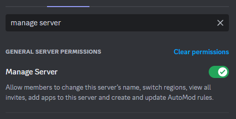
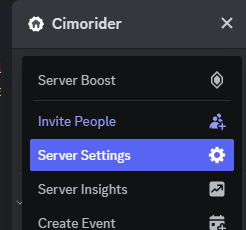
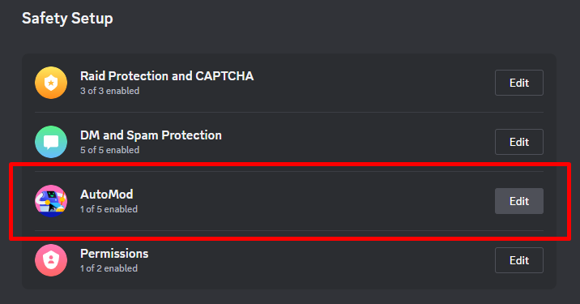
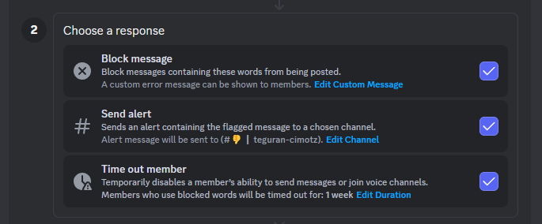
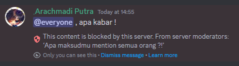
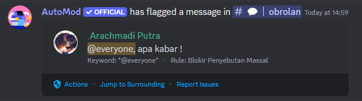
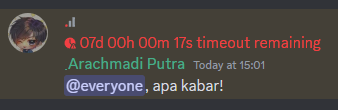
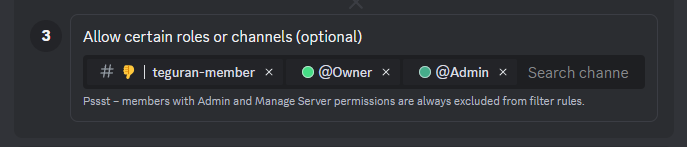
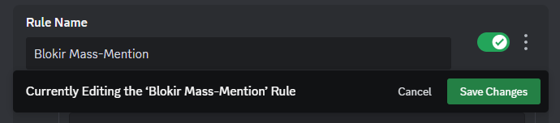
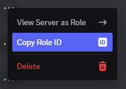

# Mencegah mass-mention dan kata terlarang

### Deskripsi

Apa itu mass-mention? Mass-mention adalah penyebutan (mention) yang akan memanggil seluruh anggota server (@everyone), atau setidaknya anggota yang sedang online/aktif saat itu (@here).

Hal ini sering terjadi dan dilakukan mulai dari member server yang iseng, hingga spammer/scammer. Sebenarnya, tidak ada alasan untuk member non-staff melakukan mass-mention selain hanya akan mengganggu member lain. Oleh karena itu, akan kita bahas cara mencegah penggunaan mass-mention ini oleh non-staff, dan memberikan peringatan serta timeout pada mereka.

Di sini kita akan memanfaatkan fitur AutoMod "Block Custom Words" di mana kita bisa mengatur kata-kata apa saja yang tidak boleh dikirimkan ke chat di server.


Jika kamu bukan pemilik server, tanyakan pada pemilik server untuk memastikan role kamu setidaknya memiliki permission "Manage Server".



### Versi Desktop / Browser



### Buka "Server Settings"

Buka menu server dengan mengklik judul server, lalu pilih "Server Settings"

<figure><figcaption>
Letak "Server Settings"
</figcaption></figure>



### Buka "Safety Setup"

Setelah tampilan "Server Settings" muncul, di baris menu kiri, pilih "Safety Setup"



### Edit "AutoMod"

Setelah tampilan "Safety Setup" muncul, klik "Edit" pada blok "AutoMod"

<figure><figcaption>
Letak "AutoMod" di "Safety Setup"
</figcaption></figure>



### Buat aturan baru

Pada tampilan "AutoMod", di bagian "Content" klik "Create" pada blok aturan "Block Custom Words"

<figure><figcaption>
Letak "Block Custom Words" di "AutoMod"
</figcaption></figure>



### Isikan `*@everyone*` dan `*@here*`

* Kamu bisa mengubah nama rule ini di "Rule Name"
* Ketik `*@everyone*` dan `*@here*` di bagian "Choose your words" dipisah dengan koma.

<figure><figcaption>
Mengisi kata yang diblokir di bagian "Choose your words"
</figcaption></figure>


**Kenapa harus diapit dengan bintang?**

Dengan mengapit kata dengan tanda bintang, kita menjelaskan pada AutoMod bahwa tidak hanya kata yang berdiri sendiri yang akan dikenai aturan, tapi juga bagian dari kata-katanya.

Ini berarti, berlaku juga untuk kata apa pun.

Misal, dengan mengisikan `*babi*` kita tidak hanya memblokir kalimat :\
`babi itu jorok` tapi juga `hewan itu membabi buta` .

Perhatikan, kalimat pertama `babi` berdiri sendiri (dipisah spasi), dan kalimat kedua `babi` memiliki awalan `mem` .




### Atur tindakan AutoMod

Di bagian "Choose a response" pilih apa saja yang akan dilakukan AutoMod, jika terdapat member yang mengirimkan mass-mention

<figure><figcaption>
Tampilan tindakan AutoMod jika terpicu
</figcaption></figure>

* **Block message**\
  Chat member yang mengandung mass-mention akan dibatalkan, dan AutoMod menampilkan pesan khusus. Pesan ini bisa kamu ubah di "Edit Custom Message".

<figure><figcaption>
Contoh pesan khusus yang muncul ke member.
</figcaption></figure>

* **Send Alert**\
  AutoMod akan mencatat pelanggaran ini ke suatu channel sebagai riwayat tindakan.

<figure><figcaption>
Tampilan riwayat tindakan AutoMod
</figcaption></figure>

* **Time out member**\
  AutoMod akan men-TO (timeout) member yang melakukan pelanggaran sesuai durasi yang ditentukan. Durasi ini bisa kamu ubah di "Edit Duration".

<figure><figcaption>
Tampilan member yang di-TO
</figcaption></figure>


Jika "Block message" tidak diaktifkan, meski "Send alert" atau "Time out member" diaktifkan, pesan tidak akan ditahan, dan tetap muncul di riwayat chat.




### Atur pengecualian

Pilih role dan/atau channel mana saja yang tidak akan dikenai aturan ini.

Jadi, jika mention dilakukan di channel ini, atau oleh member dengan role yang ada pada daftar ini, AutoMod tidak akan terpicu.

<figure><figcaption>
Tampilan channel dan role yang dikecualikan
</figcaption></figure>



### Simpan

Jangan lupa untuk selalu menyimpan perubahan yang sudah dibuat dengan mengklik "Save Changes".

<figure><figcaption>
Tampilan bilah "Save Changes"
</figcaption></figure>




Hati-hati, agar tidak menutup blok rule yang sedang kamu kerjakan.\
Menutup blok ini sama saja dengan membatalkan perubahan yang ada.



Kamu juga bisa menambahkan role dan member server untuk dicegah penyebutannya dengan cara menambahkan `*<@&Role ID>*` dan `*<@User ID>*` di bagian "Choose your words".

Role ID bisa didapatkan dengan [mengaktifkan Developer Mode](mengaktifkan-developer-mode.md) terlebih dahulu, lalu buka "Roles" di "Server Settings", klik elipsis (titik tiga) di baris role yang akan diambil IDnya, lalu klik "Copy Role ID"

.png>)

User ID bisa didapatkan dengan [mengaktifkan Developer Mode](mengaktifkan-developer-mode.md) terlebih dahulu, lalu klik kanan pada member yang ingin disalin User IDnya, lalu klik "Copy User ID"


### Versi Mobile

Untuk saat ini, agar mendapatkan hasil yang sama, gunakan Discord melalui browser perangkat mobile.
