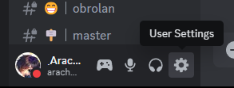
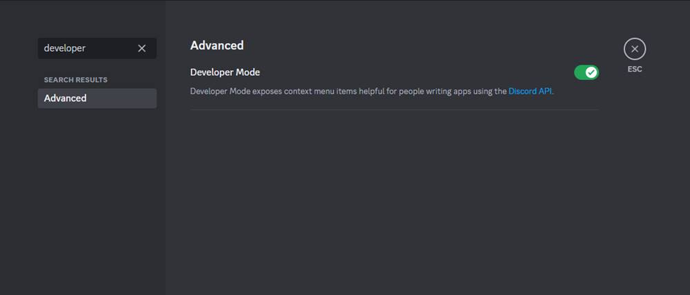
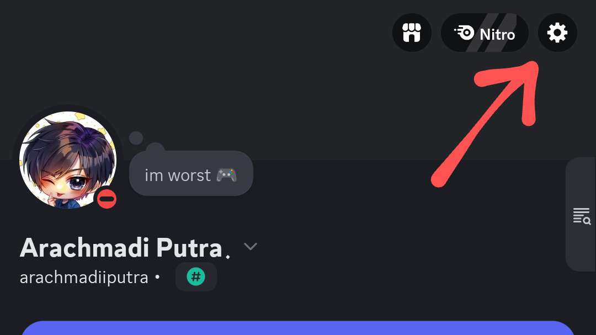
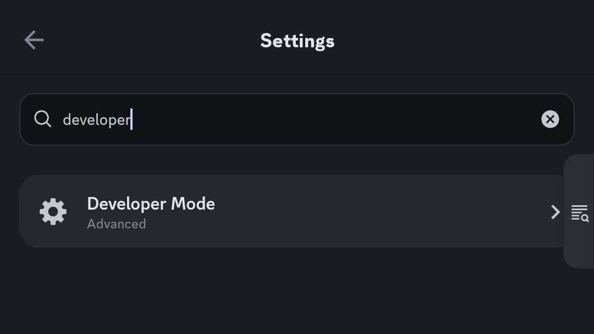
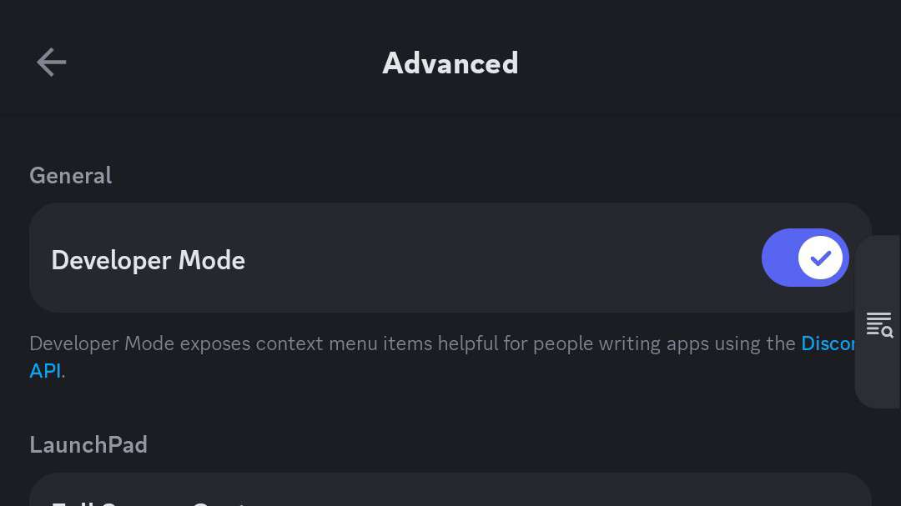

# Mengaktifkan "Developer Mode"

### Deskripsi

Beberapa tips di sini membutuhkan akses ke User ID, Role ID, dan Channel ID. Tapi, ID tersebut tidak langsung tersedia oleh karena hanya muncul ketika kita mengaktifkan Developer Mode di Discord.

Berikut adalah cara mudah untuk mengaktifkan Developer Mode di aplikasi Discord Desktop, Browser, dan Mobile (hp).

### Versi Desktop / Browser



### Buka "User Settings"

<figure><figcaption>
Letak "User Settings"
</figcaption></figure>



### Aktifkan "Developer Mode"

Di kotak "Search" ketik "developer", klik "Advanced", dan aktifkan "Developer Mode".

<figure><figcaption>
Mengaktifkan "Developer Mode"
</figcaption></figure>

Setelah Developer Mode diaktifkan, maka menu seperti Copy User ID, Copy Role ID, dan Copy Channel ID akan tersedia di menu pop-up masing-masing.



### Versi Mobile



### Buka "Settings"

Tekan ikon profilmu di kanan bawah, setelah profilmu muncul, tekan ikon gir di kanan atas.

<figure><figcaption>
Letak tombol "Settings"
</figcaption></figure>



### Buka menu "Advanced"

Di kotak "Search" ketik "developer", tekan "Developer Mode (Advanced)"

<figure><figcaption>
membuka menu "Advanced"
</figcaption></figure>



### Aktifkan "Developer Mode"

Setelah halaman "Advanced" terbuka, aktifkan "Developer Mode"

<figure><figcaption>
Mengaktifkan "Developer Mode"
</figcaption></figure>

Setelah Developer Mode diaktifkan, maka menu seperti Copy User ID, Copy Role ID, dan Copy Channel ID akan tersedia di menu pop-up masing-masing.



