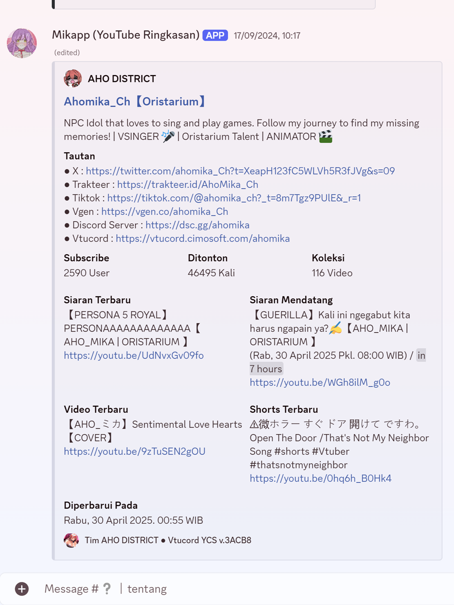
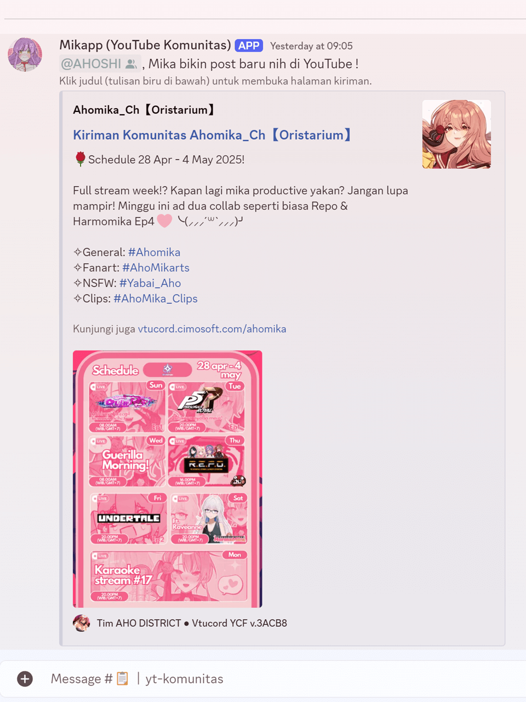
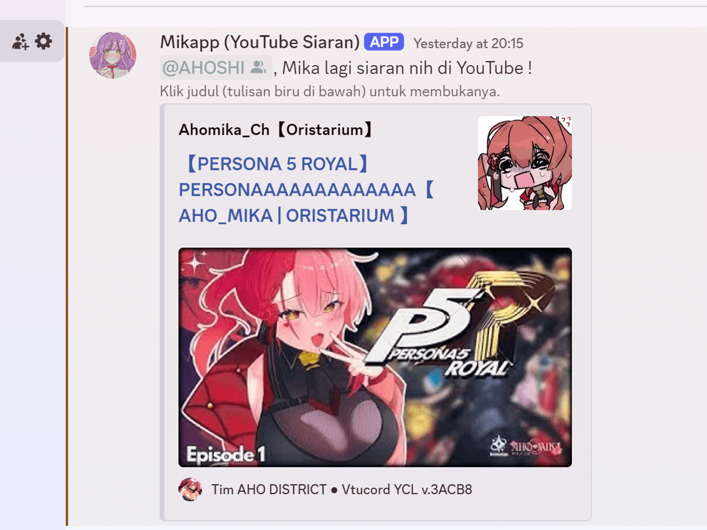
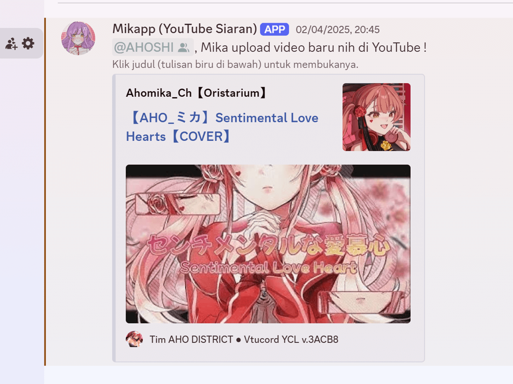
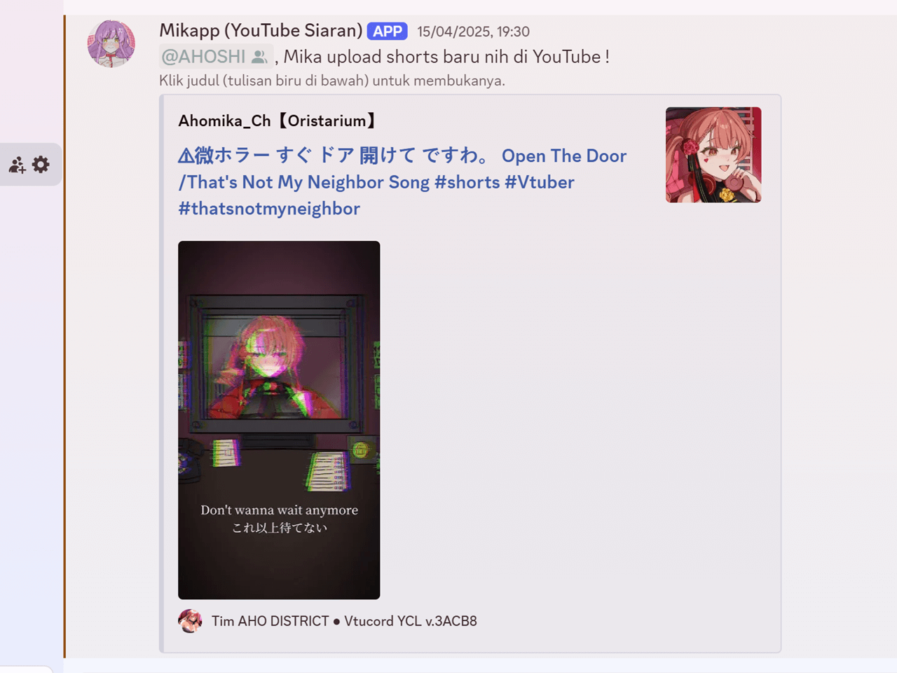
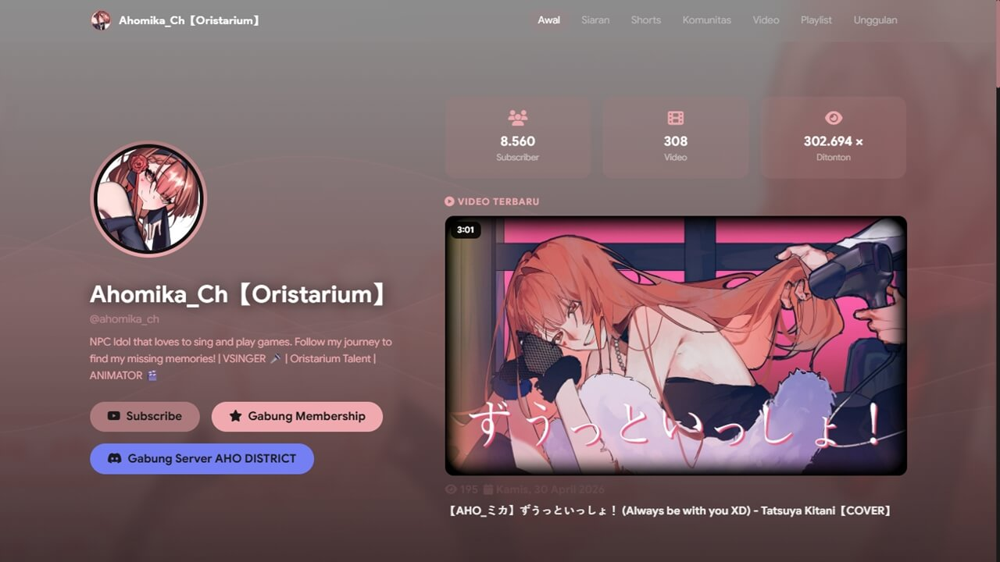

# Fitur

💬 Gratis Konsultasi Server ¹

Kami akan memberikan solusi paling efektif untuk memenuhi keinginan tentang bagaimana server VTuber PARTNER kedepannya. Seperti penambahan fitur melalui app dan sejenisnya.

¹ : Hanya paket [Buat Server VTuber Indie](https://cimosoft.gitbook.io/vtucord/produk/hnk#buat-server-vtuber-indie) / [Buat Server VTuber Agensi Pro](https://cimosoft.gitbook.io/vtucord/produk/hnk#buat-server-vtuber-agensi-pro)

🔧 Masa Manajemen Hingga 6 Bulan ¹

Vtucord 2.0 tidak hanya membuat server, tapi juga memberikan fasilitas pemantauan server selama 6 bulan / 180 hari sejak server aktif (untuk request/pembuatan server, dan 30 hari untuk update/rombak server). Ini membantu VTuber PARTNER untuk fokus mengembangkan dirinya, dan membangun interaksi dengan penggemarnya di dalam server.

¹ : Hanya paket [Buat Server VTuber Indie](https://cimosoft.gitbook.io/vtucord/produk/hnk#buat-server-vtuber-indie) / [Buat Server VTuber Agensi Pro](https://cimosoft.gitbook.io/vtucord/produk/hnk#buat-server-vtuber-agensi-pro)

🗓️ Perpanjang Masa Manajemen ³

Vtuber PARTNER bisa meminta untuk perpanjang masa manajemen server bila dirasa masih perlu bantuan untuk mengurus servernya (Syarat dan Ketentuan Tambahan Berlaku) ¹. Dalam kondisi tertentu, VTuber PARTNER akan otomatis diperpanjang masa manajemennya jika berkontribusi dalam proyek yang diadakan oleh rekan atau tim yang terkait dengan Vtucord 2.0 ².

¹ : Hanya paket [Buat Server VTuber Indie](https://cimosoft.gitbook.io/vtucord/produk/hnk#buat-server-vtuber-indie) / [Buat Server VTuber Agensi Pro](https://cimosoft.gitbook.io/vtucord/produk/hnk#buat-server-vtuber-agensi-pro)\
² : Hanya paket selain [Buat Server VTuber Agensi](https://cimosoft.gitbook.io/vtucord/produk/hnk#buat-server-vtuber-agensi)\
³ : Fitur tetap tersedia selama PARTNER masih berada di server Vtucord 2.0.

ℹ️ Informasi Terpusat

Informasi seputar Vtucord 2.0 termasuk masalah Discord secara umum, akan dikabarkan secara langsung dari server pusat kami, ke seluruh server VTuber PARTNER.

📺 Sistem Ringkasan Saluran YouTube ¹ ³

Kami menyediakan halaman landing, ringkasan channel dan pengumuman yang informatif dengan memanfaatkan data dari channel YouTube VTuber terkait sbb:&#x20;

1. Informasi ringkasan channel YouTube VTuber.

<figure><figcaption></figcaption></figure>

2. Pemberitahuan ketika VTuber membuat Postingan Komunitas di channel YouTubenya.

<figure><figcaption></figcaption></figure>

3. Pemberitahuan ketika VTuber memulai siaran.\
   Untuk mencegah misinformasi, pembuatan waitingroom tidak akan ditampilkan.

<figure><figcaption></figcaption></figure>

4. Pemberitahuan ketika VTuber mengunggah VoD/Video.

<figure><figcaption></figcaption></figure>

5. Pemberitahuan ketika VTuber mengunggah Shorts.

<figure><figcaption></figcaption></figure>

6. Halaman landing dengan data yang diambil dari channel YouTube VTuber.

<figure><figcaption></figcaption></figure>

¹ : Hanya paket [Buat Server VTuber Indie](https://cimosoft.gitbook.io/vtucord/produk/hnk#buat-server-vtuber-indie) / [Buat Server VTuber Agensi Pro](https://cimosoft.gitbook.io/vtucord/produk/hnk#buat-server-vtuber-agensi-pro)\
³ : Fitur tetap tersedia selama PARTNER masih berada di server Vtucord 2.0

🚀 Sistem Onboarding

Ucapkan selamat tinggal pada `Reaction Roles` yang seringkali bermasalah saat calon anggota server ingin menambahkan rolenya sendiri. Dengan Sistem Onboarding, calon anggota server dipastikan mendapat role _waji&#x62;_&#x6E;ya, sebelum dapat bergabung ke server.

🎫 Sistem Ticketing

Untuk mempermudah organisir informasi, segala bentuk pengaduan, termasuk pemesanan (jika VTuber membuka lapak), sepenuhnya dibuat dengan sistem tiket.

🗓️Sistem Penjadwalan Kegiatan ¹

Belum sempat edit desain schedule card buat diposting di sosial media?

Dengan memanfaatkan Google Calendar, di Vtucord sudah bisa membuat pengumuman mengenai jadwal kegiatan yang langsung bisa dibaca oleh penggemar.&#x20;

¹ : Hanya paket [Buat Server VTuber Indie](https://cimosoft.gitbook.io/vtucord/produk/hnk#buat-server-vtuber-indie) / [Buat Server VTuber Agensi Pro](https://cimosoft.gitbook.io/vtucord/produk/hnk#buat-server-vtuber-agensi-pro)

🔐 Sistem Keamanan dan Anti-Spam

Kami terus bereksperimen dengan app dan fitur yang disediakan oleh Discord untuk menciptakan komunitas yang aman dan terbebas dari spam dan akun yang terkait dengan pelanggar kebijakan Discord.

🧑‍💻 Maintenance dan Pembaruan Server ¹

Setiap saat kami selalu memantau perkembangan keamanan, kebijakan dan fitur-fitur terbaru yang diberikan oleh Discord demi efisiensi server kedepannya. Oleh karena itu, kami selalu memastikan server-server VTuber PARTNER agar tetap terbaru.

¹ : Hanya paket [Buat Server VTuber Indie](https://cimosoft.gitbook.io/vtucord/produk/hnk#buat-server-vtuber-indie) / [Buat Server VTuber Agensi Pro](https://cimosoft.gitbook.io/vtucord/produk/hnk#buat-server-vtuber-agensi-pro)

⌚ Channel Preservation ⁴

Kami memastikan bahwa seluruh channel yang sudah ada, tidak akan dihapus. Channel akan tetap dipertahankan dan digunakan kembali selama masih relevan dengan topik dan jenis dari standar konfigurasi yang kami miliki. Dan untuk channel yang tidak relevan atau kosong, akan diarsipkan.

⁴ : Hanya paket [Ubah Server VTuber Indie](hnk.md#ubah-server-vtuber-indie) / [Ubah Server VTuber Agensi](hnk.md#ubah-server-vtuber-agensi)

📡 Sistem Pengalih Live Chat YouTube ¹ ³

Menyalin kembali tautan live chat popout untuk disertakan dalam Browser Source OBS / Streamlabs setiap kali memulai siaran memang cukup mengganggu.

Oleh karena itu, kami membuatnya lebih mudah dengan memberikan URL tetap yang hanya perlu mengganti bagian kecil dari URL tersebut setiap kali akan memulai siaran, dan biarkan kami yang mendeteksi waiting room serta mengambil livechat terbaru.

¹ : Hanya paket [Buat Server VTuber Indie](https://cimosoft.gitbook.io/vtucord/produk/hnk#buat-server-vtuber-indie) / [Buat Server VTuber Agensi Pro](https://cimosoft.gitbook.io/vtucord/produk/hnk#buat-server-vtuber-agensi-pro)\
³ : Fitur tetap tersedia selama PARTNER masih berada di server Vtucord 2.0\
Paket selain yang disebut di atas, masih bisa menggunakan fitur ini. Namun terdapat iklan dan delay 10 detik.

👍 Garansi Pasca Kelulusan ¹

Kami memastikan bahwa server 100% siap dilepas dan berfungsi sepenuhnya sebelum server VTuber PARTNER diluluskan. Mengecualikan kondisi di luar kendali, seperti masalah yang terjadi pada internal penyedia app, atau perubahan yang dilakukan oleh pihak selain Vtucord.

¹ : Hanya paket [Buat Server VTuber Indie](https://cimosoft.gitbook.io/vtucord/produk/hnk#buat-server-vtuber-indie) / [Buat Server VTuber Agensi Pro](https://cimosoft.gitbook.io/vtucord/produk/hnk#buat-server-vtuber-indie)

<table data-full-width="true"><thead><tr><th align="center">FITUR</th><th align="center">BSI</th><th align="center">USI</th><th align="center">BSA</th><th align="center">BSAP</th><th align="center">USA</th></tr></thead><tbody><tr><td align="center"><a href="fitur.md#gratis-konsultasi-server">Konsultasi Server</a></td><td align="center">✔️</td><td align="center">❌</td><td align="center">❌</td><td align="center">✔️</td><td align="center">✔️</td></tr><tr><td align="center"><a href="fitur.md#masa-manajemen-hingga-6-bulan">Masa Manajemen</a></td><td align="center">6 Bulan</td><td align="center">1 Bulan</td><td align="center">❌</td><td align="center">6 Bulan</td><td align="center">1 Bulan</td></tr><tr><td align="center"><a href="fitur.md#perpanjang-masa-manajemen">Perpanjang Masa Mgmt.</a></td><td align="center">✔️</td><td align="center"><a data-footnote-ref href="#user-content-fn-1">⭕</a></td><td align="center">❌</td><td align="center">✔️</td><td align="center"><a data-footnote-ref href="#user-content-fn-1">⭕</a></td></tr><tr><td align="center"><a href="fitur.md#sistem-ringkasan-saluran-youtube">S.R.S.Y</a></td><td align="center">✔️</td><td align="center">❌</td><td align="center">❌</td><td align="center">✔️</td><td align="center">❌</td></tr><tr><td align="center"><a href="fitur.md#sistem-onboarding">Onboarding</a></td><td align="center">✔️</td><td align="center">✔️</td><td align="center">✔️</td><td align="center">✔️</td><td align="center">✔️</td></tr><tr><td align="center"><a href="fitur.md#sistem-ticketing">Ticketing</a></td><td align="center">✔️</td><td align="center">✔️</td><td align="center">✔️</td><td align="center">✔️</td><td align="center">✔️</td></tr><tr><td align="center"><a href="fitur.md#sistem-penjadwalan-kegiatan">Info Jadwal Cepat</a></td><td align="center">✔️</td><td align="center">❌</td><td align="center">❌</td><td align="center">✔️</td><td align="center">❌</td></tr><tr><td align="center"><a href="fitur.md#sistem-keamanan-dan-anti-spam">Manajemen Anti Spam</a></td><td align="center">✔️</td><td align="center">✔️</td><td align="center">✔️</td><td align="center">✔️</td><td align="center">✔️</td></tr><tr><td align="center"><a href="fitur.md#maintenance-dan-pembaruan-server">Maintenance dan Update</a></td><td align="center">✔️</td><td align="center">❌</td><td align="center">❌</td><td align="center">✔️</td><td align="center">❌</td></tr><tr><td align="center"><a href="fitur.md#channel-preservation">Channel Preservation</a></td><td align="center">❌</td><td align="center">✔️</td><td align="center">❌</td><td align="center">❌</td><td align="center">✔️</td></tr><tr><td align="center"><a href="fitur.md#sistem-pengalih-live-chat-youtube">S.P.L.C.Y</a></td><td align="center">✔️</td><td align="center"><a data-footnote-ref href="#user-content-fn-2">⭕</a></td><td align="center"><a data-footnote-ref href="#user-content-fn-2">⭕</a></td><td align="center">✔️</td><td align="center"><a data-footnote-ref href="#user-content-fn-2">⭕</a></td></tr><tr><td align="center"><a href="fitur.md#garansi-pasca-kelulusan">Garansi  Pasca Lulus</a></td><td align="center">✔️</td><td align="center">❌</td><td align="center"><a data-footnote-ref href="#user-content-fn-3">❌</a></td><td align="center">✔️</td><td align="center">❌</td></tr><tr><td align="center"><a data-footnote-ref href="#user-content-fn-4">Pengumuman Partner</a></td><td align="center">✔️</td><td align="center">✔️</td><td align="center">❌</td><td align="center">❌</td><td align="center">❌</td></tr><tr><td align="center"><a data-footnote-ref href="#user-content-fn-5">Discord Status Info</a></td><td align="center">✔️</td><td align="center">❌</td><td align="center">❌</td><td align="center">✔️</td><td align="center">✔️</td></tr><tr><td align="center"><a data-footnote-ref href="#user-content-fn-6">Pemberian Kepemilikan</a></td><td align="center">Setelah Masa Manajemen</td><td align="center">❌</td><td align="center"><a data-footnote-ref href="#user-content-fn-7">Setelah Pembayaran</a></td><td align="center">Setelah Masa Manajemen</td><td align="center">❌</td></tr></tbody></table>


Keterangan kolom:\
\- Fitur: Daftar fitur. Informasi tiap fitur tersedia dengan mengekan teks informasi fitur.\
\- BSI: Buat Server VTuber Indie.\
\- USI: Update Server VTuber Indie.\
\- BSA: Buat Server VTuber Agensi.\
\- BSAP: Buat Server VTuber Agensi Pro.\
\- USA: Ubah Server VTuber Agensi.


[^1]: Hanya jika diperlukan oleh Tim Vtucord.

[^2]: Dengan iklan dan delay 10 detik.

[^3]: Hanya server yang dibuat oleh Tim VTucord dan yang memiliki waktu manajemen yang akan dijamin kelulusannya.

[^4]: Menampilkan pengumuman / promosi dari VTuber PARTNER lain.

[^5]: Menampilkan informasi ketersediaan Discord, seperti ketika down dan sejenisnya.

[^6]: Kapan kepemilikan server diberikan (khusus "Buat Server") ?

[^7]: Setelah server selesai dibuat, dan pembayaran dikonfirmasi.
